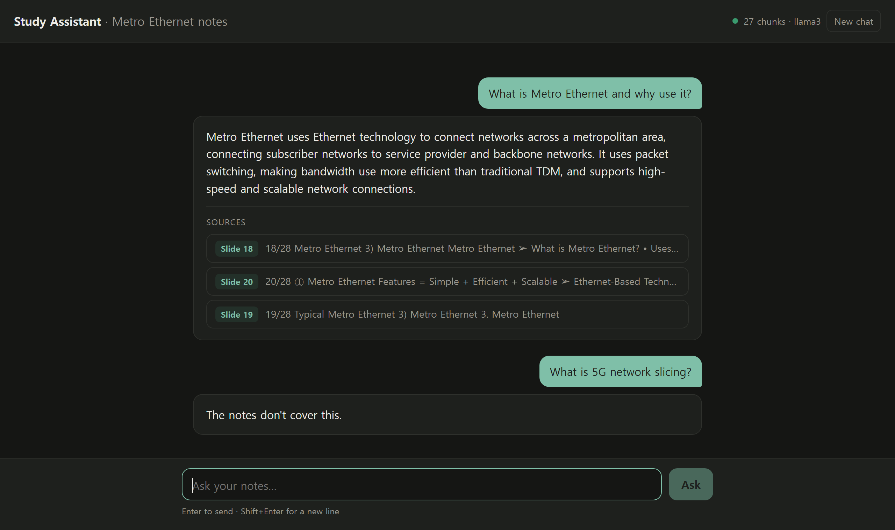
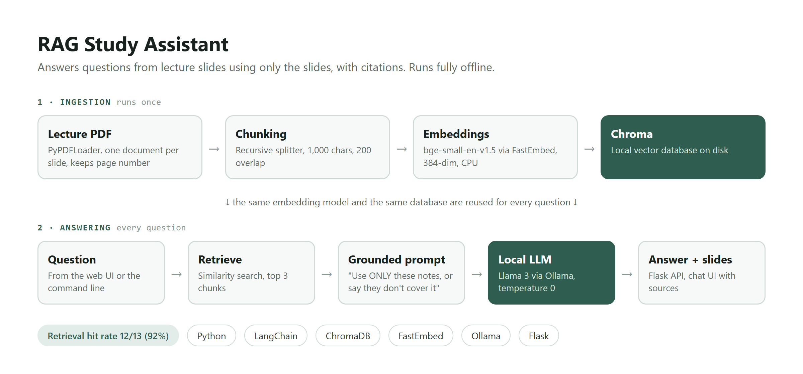
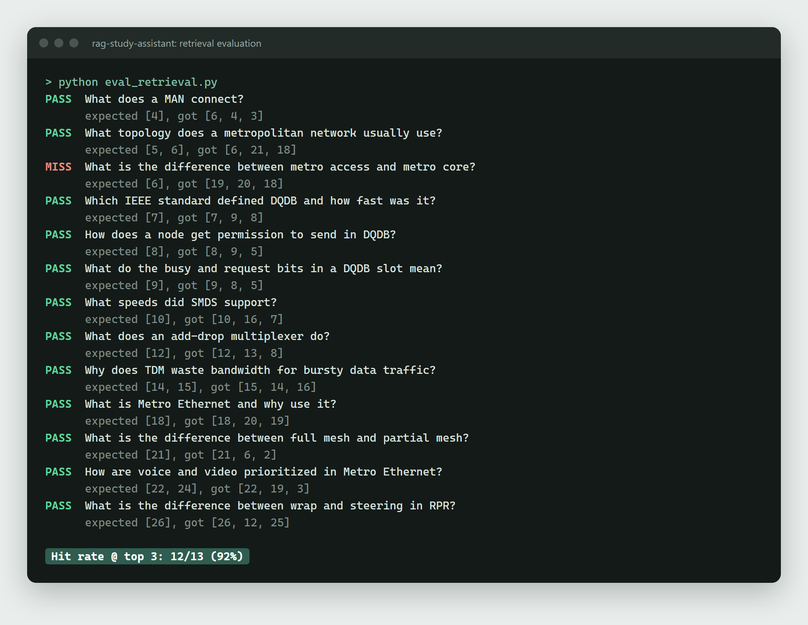

# RAG Study Assistant

Ask questions about your lecture slides and get answers drawn only from them, with the slide numbers each answer came from. Everything runs locally: no API keys, and your notes never leave your machine.

Built with LangChain, Chroma, FastEmbed (`BAAI/bge-small-en-v1.5`), Ollama (`llama3`) and Flask.



## How it works



```
Ingestion (once)     PDF -> pages -> chunks (1000 chars, 200 overlap) -> embeddings -> Chroma
Answering            question -> embedding -> top 3 chunks -> grounded prompt -> local LLM -> answer + slides
```

The prompt tells the model to answer using only the retrieved notes, and to reply "The notes don't cover this." when they don't contain the answer.

| File | Purpose |
|---|---|
| `ingest_notes.py` | Loads the PDF, splits it into chunks, embeds them, and saves them to `chroma_db/` |
| `query_notes.py` | Retrieval only: prints the chunks that match a question (useful for debugging) |
| `ask_notes.py` | Full RAG: retrieves chunks and has the local LLM write an answer |
| `eval_retrieval.py` | Retrieval test: 13 questions with known answer slides, reports the hit rate |
| `app.py` | Flask web server: `GET /`, `GET /api/status`, `POST /api/ask` |
| `static/index.html` | Chat interface |

## Setup

1. Install [Ollama](https://ollama.com) and download the model:
   ```
   ollama pull llama3
   ```
2. Create a virtual environment and install dependencies:
   ```
   python -m venv .venv
   .venv\Scripts\activate
   pip install -r requirements.txt
   ```
3. Add your own lecture slides as a PDF. Course slides are usually copyrighted, so they are not included in this repo and `*.pdf` is git-ignored.
4. Build the notes database (once, or whenever the PDF changes):
   ```
   python ingest_notes.py path\to\your_slides.pdf
   ```
   With no argument it looks for `Chap3_Metro_Ethernet.pdf` in the project folder. The example questions in the web UI and `eval_retrieval.py` were written for that chapter (Computer Networks, Ch. 3: Metro Ethernet), so update them for your own notes.

## Usage

**Web app**
```
python app.py
```
Then open http://127.0.0.1:5000. The first answer can take a few minutes on CPU while the model loads.

**Command line**
```
python ask_notes.py "What is Metro Ethernet?"
python query_notes.py "What is Metro Ethernet?"
```

**Evaluate retrieval** (a few seconds, no LLM needed)
```
python eval_retrieval.py
```
Current result: 12/13 (92%) of questions retrieve the correct slide in the top 3.



To use a different Ollama model, set `OLLAMA_MODEL` (for example `gemma3:4b`). If the chosen model isn't installed, the app falls back to any installed model.

## Limitations and next steps

- Only text is read from the slides; diagrams are ignored.
- Each question is independent (no chat memory).
- Slides that are mostly diagrams (like slide 19) produce near-empty chunks that still get retrieved and crowd out useful ones.
- Ideas to add: streaming answers, hybrid keyword + vector search, filtering out near-empty chunks, and PDF upload.
